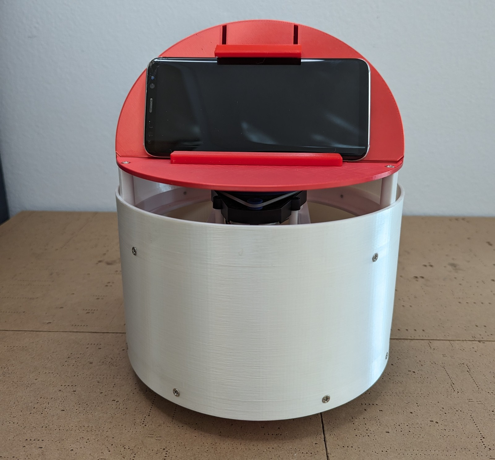

# Maker's Pet Loki 200 mm LiDAR Home Robot (Refurbished)



A 3D-printed 200 mm round home robot with two brushless gearmotors, a 360-degree LiDAR, an ESP32 running the Kaia.ai micro-ROS firmware and a phone face. It maps rooms and drives itself with ROS 2. This is a refurbished remix of [Maker's Pet Loki](https://github.com/makerspet/3d_models) by makerspet (Maker's Pet).

## Install and build guide

Refurbished remix of Maker's Pet Loki (Apache-2.0). Upstream design by makerspet; this guide puts printing, assembly and setup in build order.

### 1. Print the parts

Material: PETG (preferred) or PLA, 0.2 mm layers, 3 perimeters, 15-20 % infill. Total about 0.5 kg. All parts fit a 220 x 220 mm bed.

| File | Print | Notes |
|---|---|---|
| Bottom plate.stl | 1 | Motor and caster deck |
| Middle plate.stl | 1 | Electronics and battery deck |
| Upper plate.stl | 1 | LiDAR deck |
| Head.stl | 1 | Phone holder shell |
| Bumper front.stl | 1 | |
| Bumper back.stl | 1 | |
| Motor bracket x2.stl | 2 | The file holds one bracket |
| Caster wheel with break-off pedestal.stl | 1 | Snap the pedestal off after printing |
| Battery 3x9V Upright Pedestal.stl | 1 | |
| Battery Pack 3x9V Upright.stl | 1 | |
| Battery Pack 3x9V Upright Lid.stl | 1 | |
| Handset Clamp.stl | 1 | Phone clamp |
| Handset Footrest.stl | 1 | Phone rest |
| One LiDAR plate | 1 | Pick the plate for your sensor (below) |

LiDAR plates: YDLidar X4 plate.stl, YDLIDAR X3 PRO plate.stl, YDLIDAR X2 Plate.stl, YDLIDAR X2L Plate.stl, RPLIDAR A1 Plate.stl, Neato XV11 Plate.stl, LDS02RR Plate.stl.

### 2. Buy the parts

See the shop list (bom.yaml / BOM PDF). Core parts: ESP32 DevKit (30-pin), one LiDAR, two Chihai GM25 2418 24 V brushless gearmotors with built-in driver, two 65 mm wheels with hex couplings, three 9 V batteries with snap leads and an XT30 plug, M2.5/M3 screws.

The Maker's Pet ESP32 main board (motor, LiDAR and battery connectors, 5 V regulator, power switch) is bought directly from Maker's Pet at makerspet.com. You need one. It is not in the shop list.

Motor speed choice: 260 rpm is the default. Use 200 rpm for thick carpet or extra load, 408 or 450 rpm for more speed. All share the same 2418 size and connector.

### 3. Assemble

1. Mount both gearmotors to the bottom plate with the motor brackets. Fit the 65 mm wheels.
2. Fit the caster wheel at the other end of the bottom plate.
3. Build the battery pack: wire three 9 V snaps in series (about 27 V), fit them in the battery pack and lid, end the lead in an XT30 plug. Fit it on the pedestal.
4. Mount the ESP32 on the main board. Fit the board on the middle plate and plug in the motor cables and battery lead. Leave the power switch off.
5. Stack the middle plate on the bottom plate, then the upper plate.
6. Mount your LiDAR on its plate and fit it on the upper plate. Connect its cable to the main board. LDS02RR needs the Maker's Pet adapter board between sensor and main board.
7. Fit the bumpers, then the head with the phone clamp and footrest.

The Maker's Pet YouTube channel has an assembly video for Loki that shows each step.

### 4. Firmware and software

1. Install the Arduino IDE with ESP32 support and the libraries micro_ros_kaia, LDS, PID_Timed and ESPAsyncWebSrv (with AsyncTCP).
2. Flash the Kaia.ai firmware (github.com/kaiaai/firmware) to the ESP32 over USB.
3. Set the robot model (Loki), your motor model and your LiDAR model in the firmware configuration, then connect the robot to your Wi-Fi.
4. On your PC, run the Kaia.ai ROS 2 Docker image (github.com/kaiaai/docker) and connect to the robot.
5. Drive it by teleop first, then try mapping and navigation.

### 5. First power-up checks

- Wheels off the ground for the first motor test. Both wheels should turn the way the firmware expects; swap the motor setting if one runs backwards.
- The LiDAR should spin and show a scan in the ROS 2 viewer before you try mapping.
- Replace the 9 V batteries when the robot slows or the ESP32 resets under load.

### Safety

Never look into the LiDAR laser and keep children and pets from doing so; mirrors and glossy surfaces can reflect the beam. Disconnect the battery before changing wiring. Do not short the 27 V battery pack.

### Credits

Maker's Pet Loki by makerspet (github.com/makerspet), Apache-2.0. Firmware and ROS 2 software by Kaia.ai. Changes in this remix: combined purchase list, print table with counts, one build guide in build order.

### Software and source links

- Kaia.ai ESP32 firmware: https://github.com/kaiaai/firmware
- Kaia.ai ROS 2 Docker image for your PC: https://github.com/kaiaai/docker
- Robot project page with the assembly video and notes: https://github.com/makerspet/makerspet_loki
- 3MF copies, optional mods (bumper, ears) and Fusion 360 sources: `source/upstream/loki_200mm/` in this repository.

## Documentation download

This repository is the documentation and source download for the build.

- **Download ZIP:** use GitHub's **Code → Download ZIP** button, or clone:

  ```bash
  git clone https://github.com/ToolKnox/hawkridge-makerspet-loki-lidar-pet-robot.git
  ```

- **Build guide:** this README, also as [`docs/build-guide.md`](docs/build-guide.md).
- **Print files (STL, 20 parts):** [`source/upstream/loki_200mm/stl/`](source/upstream/loki_200mm/stl/)
- **3MF copies of the print files:** [`source/upstream/loki_200mm/3mf/`](source/upstream/loki_200mm/3mf/)
- **Optional mods (bumper, ears):** [`source/upstream/loki_200mm/mods/`](source/upstream/loki_200mm/mods/)
- **Editable CAD (Fusion 360):** [`source/upstream/loki_200mm/fusion360/`](source/upstream/loki_200mm/fusion360/)
- **Robot project and assembly notes (separate repository):** https://github.com/makerspet/makerspet_loki
- **Kaia.ai ESP32 firmware (separate project):** https://github.com/kaiaai/firmware
- **Kaia.ai ROS 2 Docker image (separate project):** https://github.com/kaiaai/docker
- **Original upstream README:** [`source/upstream/README.md`](source/upstream/README.md)

## Repository contents

- `docs/`: the build guide and the upstream mirror manifest.
- `download-documentation/`: how to download this package.
- `images/`: cover photo.
- `source/upstream/`: mirror of the upstream project at commit `42d7b7956bd6d54b8cff79f26c2f1d54f677ea18`, with the Loki 200 mm STL, 3MF, mod and Fusion 360 files.

Not included in this repository: the larger Fido 250 mm and Snoopy 300 mm robots from the same upstream model repository. They are not needed for Loki.

## Credits and license

Remix of [Maker's Pet Loki](https://github.com/makerspet/3d_models) by makerspet (Maker's Pet), Apache License 2.0. Mirrored from commit [`42d7b79`](https://github.com/makerspet/3d_models/tree/42d7b7956bd6d54b8cff79f26c2f1d54f677ea18). The cover photo is from the [makerspet_loki](https://github.com/makerspet/makerspet_loki) README by the same owner. The upstream license is kept at [`LICENSE`](LICENSE) and [`source/upstream/LICENSE`](source/upstream/LICENSE). No endorsement by the original authors is implied.

Changes by Hawkridge, updated for modern use: one combined purchase list, a print list with counts and a single build guide in build order. Files under `source/upstream/` are unmodified.
